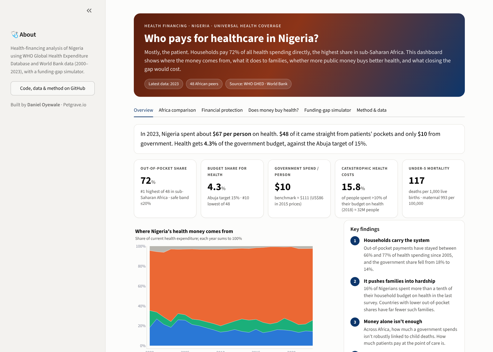
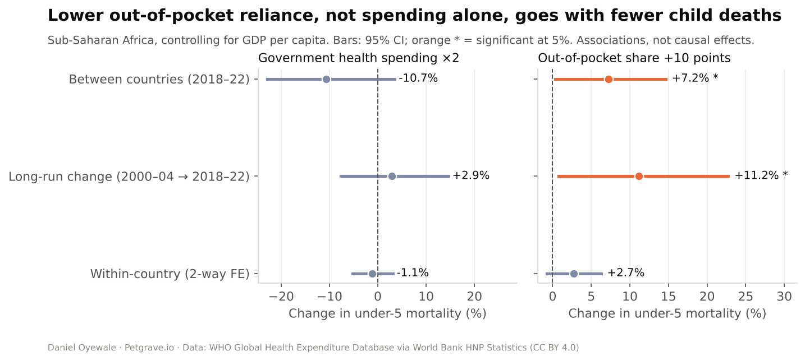
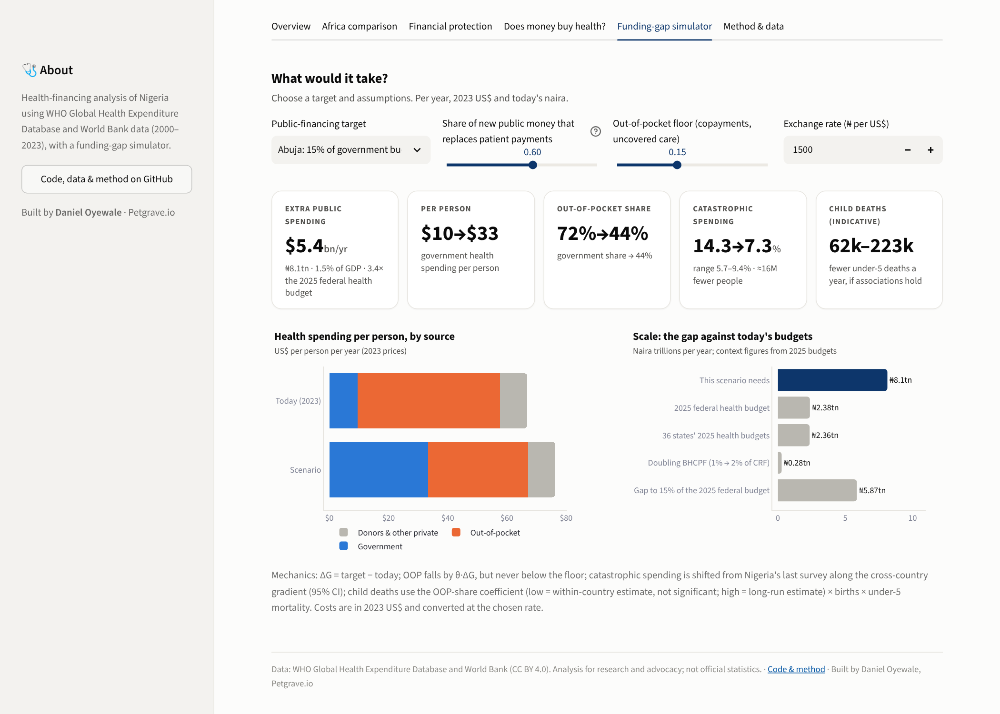
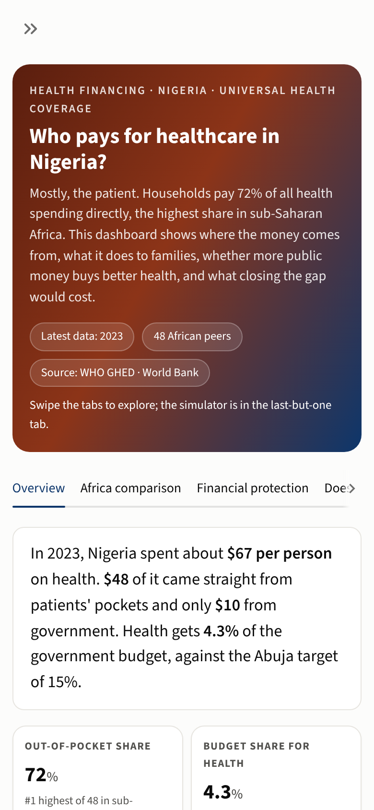

# Who pays for healthcare in Nigeria?

**Mostly, the patient.** In 2023 Nigerian households paid **72%** of all health spending out of pocket, the highest
share of 48 countries in sub-Saharan Africa. This project shows where Nigeria's health money comes from, what paying
at the point of care does to families, whether more public money is linked to better health across Africa, and what
closing the funding gap would cost.

**Live dashboard:** *(link after deployment)* · **Policy brief:** [`reports/policy_brief.pdf`](reports/policy_brief.pdf)



## Key findings (Nigeria, 2023)

| | Nigeria | Benchmark |
|---|---|---|
| Out-of-pocket share of health spending | **71.9%** (#1 of 48 in SSA) | 15–20% (WHO) |
| Health share of government spending | **4.3%** | 15% (Abuja Declaration) |
| Government health spending | **$9.58 per person**, 0.6% of GDP | ≈$111 (US$86 in 2015 $), 5% of GDP |
| People spending >10% of their budget on health | **15.8%** (2018 survey, ≈32M people) | down from 22.5% in 2003 |
| Under-5 mortality | **117** per 1,000 live births | |

1. **Households carry the system.** The out-of-pocket share has stayed between 66% and 77% since 2005, while the government share slipped from 18% to 14%.
2. **It pushes families into hardship.** Across 142 countries, a 10-point fall in the out-of-pocket share goes with about 22% fewer people facing catastrophic health costs.
3. **Money alone isn't enough.** In a panel of 46 African countries (2000–2023), the level of government health spending is not significantly linked to under-5 mortality. The out-of-pocket share is: a 10-point fall goes with about 11% lower under-5 mortality over the long run (p = 0.035). These are associations, not causal effects.
4. **The Abuja target would cost about $5.4bn a year** (≈₦8.1tn, 1.5% of GDP, 3.4× the 2025 federal health budget). If 60% of the new money replaces patient payments, the out-of-pocket share falls from 72% to 44% and catastrophic spending roughly halves (≈16M fewer people).



## Funding-gap simulator

Pick a target (Abuja 15%, 5% of GDP, US$86 per person, or custom) and test the assumptions: how much new public money
replaces out-of-pocket payments (θ), the out-of-pocket floor, and the exchange rate. The simulator reports the cost in
dollars, naira and % of GDP; the new financing mix; catastrophic spending with a 95% range; and an indicative range for
under-5 deaths. It flags scenarios that go beyond anything African countries have achieved.

| Target (θ = 0.6) | Extra per year | % GDP | Out-of-pocket share | Catastrophic spending |
|---|---|---|---|---|
| Abuja: 15% of budget | $5.4bn | 1.5% | 72% → 44% | 14.3% → 7.3% |
| 5% of GDP | $16.0bn | 4.4% | 72% → 15% (floor) | 14.3% → 3.6% |
| US$86 per person | $23.0bn | 6.3% | 72% → 15% (floor) | 14.3% → 3.6% |

<p align="center"> </p>

## Data

| Source | Content | Licence |
|---|---|---|
| [World Bank Health Nutrition and Population Statistics](https://datacatalog.worldbank.org/search/dataset/0037652) (WHO Global Health Expenditure Database) | Health spending by source, SDG 3.8.2 catastrophic spending, mortality, UHC index | CC BY 4.0 |
| [World Bank WDI: GDP per capita, PPP](https://data.worldbank.org/indicator/NY.GDP.PCAP.PP.KD) | Income control | CC BY 4.0 |
| [`data/reference/assumptions.csv`](data/reference/assumptions.csv) | Benchmarks, 2025 budget figures, NHIA enrolment, and all assumptions, with sources | |

To rebuild from scratch, download both bulk CSV zips into `data/raw/` and run the pipeline below. The processed panel
and model results are committed, so the dashboard and tests run without the raw files.

## Method

- **Financing mix:** government, external, out-of-pocket and other private shares of current health expenditure, rescaled to sum to 100%.
- **Financial protection:** log-linear cross-country curve of catastrophic spending (>10% of budget) on out-of-pocket share (latest survey since 2010; n = 142, R² = 0.21).
- **Does money buy health?** Two-way fixed-effects panel (country and year effects, clustered SEs, spending lagged one year) of log under-5 mortality, log maternal mortality and the UHC index on log government health spending per person (PPP), out-of-pocket share and log GDP per capita. Checked with long-difference (2000–04 → 2018–22) and cross-section models, and robustness runs without the lag, without Nigeria, and without the OOP term.
- **Simulator:** ΔG = target − today; OOP falls by θ·ΔG, never below the floor. Catastrophic spending is shifted from the 2018 survey along the curve. Child deaths use the out-of-pocket coefficient (low = within-country, high = long-run) × births × under-5 mortality.

**Limitations:** associations, not causes; mortality series are modelled estimates; the last catastrophic-spending
survey is from 2018; the simulator holds everything else constant; θ and the floor are assumptions.

## Run it

```bash
pip install -r requirements-dev.txt
streamlit run app/streamlit_app.py
pytest -q

# rebuild (needs data/raw/*.zip)
export PYTHONPATH=src
python -m healthfin.ingest && python -m healthfin.model && python -m healthfin.figures && python -m healthfin.brief
```

```
src/healthfin/   ingest · financing · model · simulator · figures · brief
app/             Streamlit dashboard (UI only)
data/            processed panel + model results (committed), reference assumptions, raw zips (ignored)
reports/         figures and the two-page policy brief
tests/           data, model, simulator and app tests
```

## Author

**Daniel Oyewale** · data analyst, data strategist and sustainability researcher at Petgrave.io.
Licensed under MIT; data under CC BY 4.0 (World Bank / WHO).
